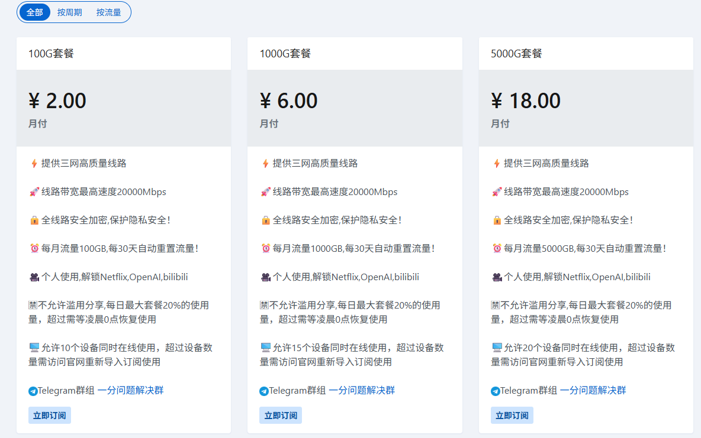
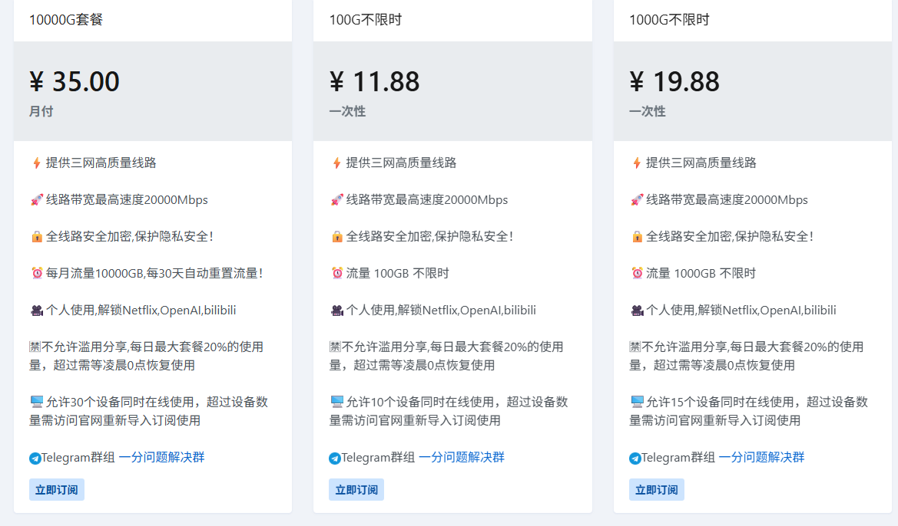

# VPN_jctj
2026最有性价比机场推荐(翻墙)，便宜稳定才是王道！不定时更新！

有好用的欢迎提Issues。确实好用我再推荐给大家。

==**为什么要收藏我？**==

1、整理所有仓库地址，并且做综合分析。

2、我推荐的都是我自己用的。

3、也是一个找其他项目入口，并比他们分析。

4、本项目保证可以找到一款适合你的。

## 一、性价比推荐

1、[一分机场](https://xn--4gqx1hgtfdmt.com/#/register?code=wBLzmsry)

是目前我用过最便宜的机场，而且还稳定。套餐如下图。

## 二、其他机场项目收集

1. **[panda-vpn-pro](https://github.com/DiningFactory/panda-vpn-pro)** 16K

2. **[SSR-V2ray-Trojan](https://github.com/hwanz/SSR-V2ray-Trojan)** 21.3k

   大家可以参考，这里面是比较专业稳定机场。

3. **[fly](https://github.com/029danio/fly)**

4. **[kjfx](https://github.com/kjfx/kjfx)**

5. **[jichangtuijian](https://github.com/VPN-tuijian/jichangtuijian)**

6. **[SSV2RayTrojanSSRClash](https://github.com/OverTheWallNode/SSV2RayTrojanSSRClash)** 2.9K Star

7. **[v2rayNvpn](https://github.com/githubvpn007/v2rayNvpn)** 7.1k

## 三、软件下载

待添加！！！

😊 最后，如果觉得这篇推荐对你有所帮助，那么不妨点一下右上角的 `star` ⭐，这将让我更有动力保持更新。💚 **感谢你能看到此处** 💚。
