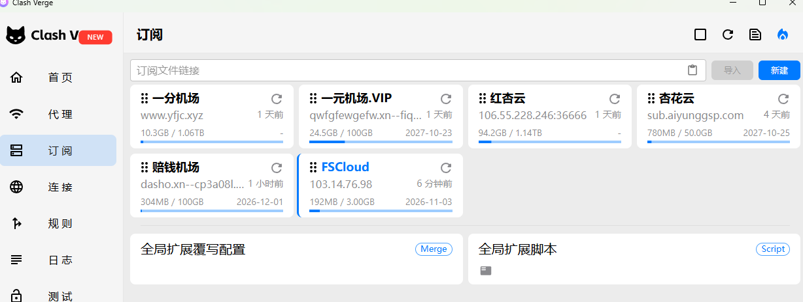

# VPN_jctj
2026最有性价比机场推荐(翻墙)，便宜稳定才是王道！不定时更新！

有好用的欢迎提Issues。确实好用我再推荐给大家。

**⭐为什么要收藏我？**

1、整理所有仓库地址，并且做综合分析。

2、我推荐的大多是我自己用的。

3、⭐**也是一个找其他项目入口，并对他们进行简单分析。**

4、⭐**本项目保证可以找到一款适合你的。**

## 一、性价比推荐

> 是目前我用过最便宜的机场，而且还稳定。特点这反正便宜，就算跑路也无所谓。
>
> 下以为自用测试(**自下用如图**)，欢迎使用反馈。（建议使用两家及以上）
>
> **--2026年10月31日**（图）
>
> 
>
> 

>   
<b>1. --2026年10月31日（图）</b>

>       alt="--2026年10月31日（图）"
>      style="width:100%; float:left; margin-right:12px;" />
> 

| 机场名                                                       | 特点                                                         | 最低(月)套餐                | 最低不限时                   |
| ------------------------------------------------------------ | ------------------------------------------------------------ | --------------------------- | ---------------------------- |
| **[一分机场](https://xn--4gqx1hgtfdmt.com/#/register?code=wBLzmsry)** | ⭐**便宜好用，强烈推荐，稳定**--自用2年。(**访问需扶墙**)     | ⭐2￥/100G                   | 11.88￥/100G，⭐19.88￥/1000G |
| [一元机场](https://vgvg.vg#/register?code=0KLuGDda)          | ⭐包年便宜，访问不用扶墙。--自用1年                           | 7￥/100G，12￥(年)/100G月   | ---                          |
| [杏花云](https://216.236.61.23:8888/#/register?code=PLD3m9ca) | ⭐相对便宜，访问不用扶墙。--自用5月                           | 3￥/200G，12￥(年)/50G月    | 20￥/1000G年                 |
| [飞鸟云](https://a1.170809.xyz/#/register?code=P5VrczBK)     | 包年便宜(**访问需扶墙**)                                     | 10￥/200G，12￥(年)/50G月   | 10￥/200G                    |
| [FSCloud](https://web.fscloud.app/#/register?code=dDGiGWbI)  | ⭐**3天免费试用**(**访问需扶墙**)                             | 12￥/1.2TB，13￥(年)/100G月 | 99￥/1000G                   |
| [魔戒](https://74.82.196.10:8000/register?aff=al3J9aJ1)      | 便宜体验，全是一次性套餐，访问不用扶墙                       | ---                         | 1￥/1G，19.9￥/130G          |
| [STC-SERVER](http://acad.stc-spadesdns.com/auth/register?code=oQYc) | 贵但稳定。推荐按量付费。--自用5年(**访问需扶墙**)。          | ---                         | **0.8￥ /G**                 |
| [良心云](https://xn--9kqz23b19z.com/#/register?code=HSZW4gB8) | 月套餐多，覆盖各种价位，满足各种要求。自用2月。(**访问需扶墙**) | 2￥/100G，4￥/500G          | ⭐21￥/1000G                  |
| [陪钱机场](https://xn--mes358aby2apfg.com/register?code=jJ7WmPNz&cover=sfw) | 便宜好用，速度快。--自用2月。(**访问需扶墙**)                | 2￥/100G，4￥/500G          | ⭐18.9￥/1000G                |
| [inets](https://inets.io/#/register?code=R5HwzjhB)           | 准备试用。访问不用扶墙。缺点偏贵。                           | 7.5￥/50G                   | ---                          |
| [边缘节点](https://nvbnb.lonka.click/#/?code=KDyaOdpf)       | ⭐全专线，多价位，最高 2.5Gbps 稳定速率(**访问需扶墙**)       | 15￥/50G                    | 99￥/100G                    |
| [全球云](https://n3oplhjnm.quanqiugttt1.club/#/?code=uu8OCLjk) | 不限速，全面支持，访问不用扶墙。缺点偏贵。                   | 20￥/120G                   | 100￥/100G                   |
| [红杏云](https://hxlove25s.cc/web/#/login?code=IUh11UC9)     | 好在稳定，偏贵。访问不用扶墙。--自用2年(时而优惠)            | 20￥/200G                   | 388￥/3000G                  |
| [香蕉加速](https://b.banana06.win/auth/register?code=4uPD)   | ⭐贵！稳定！企业推荐！(**访问需扶墙**)                        | 33￥/100G-企业线路          | ---                          |

## 二、其他机场分享项目收集

| Github项目                                                   | 类型简介                                      | ⭐Start       |
| ------------------------------------------------------------ | --------------------------------------------- | ------------ |
| **[SSR-V2ray-Trojan](https://github.com/hwanz/SSR-V2ray-Trojan)** | 专业稳定，偏贵。                              | ⭐Start 21.3k |
| **[panda-vpn-pro](https://github.com/DiningFactory/panda-vpn-pro)** | **相对便宜推荐，很多心得体会。**（⭐推荐观看） | ⭐Start  16K  |
| **[v2rayNvpn](https://github.com/githubvpn007/v2rayNvpn)**   | 大家可以参考，这里面是比较专业稳定机场。      | ⭐Start 7.1k  |
| **[fly](https://github.com/029danio/fly)**                   | 机场节点评测，每月更新                        | ⭐Start 3.2k  |
| **[SSV2RayTrojanSSRClash](https://github.com/OverTheWallNode/SSV2RayTrojanSSRClash)** | 有中级、高级推荐，⭐**中端有很多免费试用机场** | ⭐Start 2.9k  |
| **[jichangtuijian](https://github.com/VPN-tuijian/jichangtuijian)** | 中端测评。最低15￥/月                         | ⭐Start 2.7k  |
| **[kjfx](https://github.com/kjfx/kjfx)**                     | 简单列表，介绍不够详细，待测试！              | ⭐Start 881   |

## 三、软件下载

[软件下载（Windows/Android/macOS/iOS）](https://github.com/Kejifaxian/welcome/)

## 四、计划任务

- [x] 对使用机场有表格分析（价格，推荐原因，稳定性）--2026年10月31日
- [x] 对市面上机场项目做分析（专注点，特点，价位，Star）--2026年10月31日
- [x] 完善软件下载地址统计 --2026年10月31日

😊 最后，如果觉得这篇推荐对你有所帮助，那么不妨点一下右上角的 `star` ⭐，这将让我更有动力保持更新。💚 **感谢你能看到此处** 💚。
